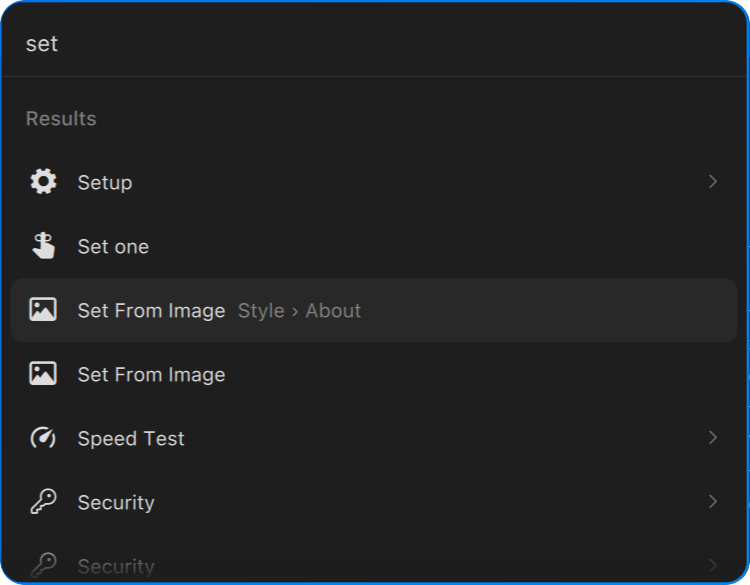

# Supermenu

A Raycast-style launcher for the [Omarchy](https://omarchy.org) 4 (Quickshell)
shell. One search box over every application and every entry in the Omarchy
menu, ranked by what you actually pick: type a query you have used before and
what you chose last time comes first.



- **Everything in one list.** Apps, Omarchy's commands and its submenus are
  searched together. The selected row shows where it lives (`Setup › Network`),
  and a submenu is marked with a chevron.
- **It learns your queries.** Pick Tailscale after typing `sc` and the next `sc`
  puts Tailscale first, although Screenshot and Screensaver match `sc` better.
  What you learn stays with that query and the shorter ones it starts with:
  the same pick puts Tailscale first for `s` too, at half the weight, until
  that fades in ten days or so. Other queries are untouched.
- **It learns what you use.** Frequently used things drift up in every search.
  With nothing typed it shows Omarchy's own menu, in Omarchy's order.
- **Fuzzy where it helps.** `lw` finds LibreOffice Writer, `vsc` VSCode,
  `setup dns` the DNS entry under Setup.
- **Omarchy's data, Omarchy's look.** It reads the same menu files, runs the
  same `when:` / `checked:` guards and the same app library as the Omarchy menu,
  and draws itself in the active theme's menu colours. Unlike that menu it
  leaves the screen behind it undimmed, as Raycast does; `backdrop` in
  `Supermenu.qml` turns the dimming back on.

## Requirements

- Omarchy 4 (Quattro) and its Quickshell-based shell
- Hyprland, for the global-shortcuts protocol the keybind uses

## Install

```bash
omarchy plugin add https://github.com/cllpse/omarchy-cllpse-plugin-supermenu.git --enable
```

**Then install the keybind.** The plugin registers a global shortcut and waits
for the compositor to send it, so until this is in place `SUPER+SPACE` still
opens Omarchy's own menu. Append
[`hypr/supermenu-bindings.lua`](hypr/supermenu-bindings.lua) to
`~/.config/hypr/bindings.lua`:

```bash
cat ~/.config/omarchy/plugins/cllpse.supermenu/hypr/supermenu-bindings.lua \
  >> ~/.config/hypr/bindings.lua
hyprctl reload
```

That file unbinds Omarchy's `SUPER+SPACE` and binds it to the supermenu. Omarchy's
menu itself is untouched: `SUPER+ALT+SPACE` still opens its apps list, and every
script that uses it as a pick-from-a-list prompt still does.

Optionally append [`hypr/supermenu-looknfeel.lua`](hypr/supermenu-looknfeel.lua)
to `~/.config/hypr/looknfeel.lua` for a map fade, and to spare the invisible
keystroke catcher a fade on every open. Its blur rule is in there commented
out: blur on a full-screen layer halved the frame rate (measured on the window
switcher), and an opaque card has nothing to blur through:

```bash
cat ~/.config/omarchy/plugins/cllpse.supermenu/hypr/supermenu-looknfeel.lua \
  >> ~/.config/hypr/looknfeel.lua
hyprctl reload
```

## Remove

```bash
omarchy plugin remove cllpse.supermenu
rm -f ~/.local/state/omarchy/cllpse.supermenu.json
```

Then delete the blocks you appended to `~/.config/hypr/bindings.lua` and
`~/.config/hypr/looknfeel.lua` and run `hyprctl reload`, which gives
`SUPER+SPACE` back to the Omarchy menu. The plugin writes one file, its usage
history, and nothing else.

## Using it

| | |
|---|---|
| `SUPER+SPACE` | open / close |
| type | search |
| `↑` `↓`, `Tab` `Shift+Tab`, `Ctrl+N` `Ctrl+P`, `Ctrl+J` `Ctrl+K` | move |
| `PgUp` `PgDn` | move eight rows |
| `Enter` or click | open the app, run the command, enter the submenu |
| `→` at the end of the query | enter the highlighted submenu |
| `Esc` | clear the query, then leave the submenu, then close |
| `Backspace` or `←` on an empty query | leave the submenu |
| `Ctrl+U` | clear the query |
| click outside the card | close |

Inside a submenu the search covers only what is under it, and rows show their
path from there.

It can also be opened at a submenu, or with a query, through the shell:

```bash
omarchy-shell shell summon cllpse.supermenu '{"menu":"style"}'
omarchy-shell shell summon cllpse.supermenu '{"query":"theme"}'
```

`menu` takes an id or any alias Omarchy's menu declares, as
`omarchy menu summon` does, and a route naming a command runs it.

## How results are ordered

An exact name first, then what you picked for this exact query before, then
fuzzy match quality plus a small usage term. Every count halves every two weeks,
and the history is one small file you can delete. The rules in full, and where
the data comes from: [`docs/ranking.md`](docs/ranking.md). Keystroke cost,
the fast-typing hand-off and an upstream gap: [`docs/internals.md`](docs/internals.md).

## Theming

The card binds the active theme's menu colours and Hyprland's
`decoration:rounding`, so it tracks your theme with nothing to configure. One
size can be pinned from a theme's `[spacing]` section, as the window switcher's
are:

| token | default | what it sets |
|---|---|---|
| `supermenu-card-padding` | 6 | space between the card's border and its contents: the rows' side inset, the list's top and bottom margins, the space above the search field |

The selected row's corner is concentric with the card's: Hyprland's rounding,
less the distance from the card's edge in to the rows (border plus
`supermenu-card-padding`). Padding at or past the rounding gives square rows.

## Notes

- **One overlay at a time.** Opening the card sends
  `custom>>overlay-open>>cllpse.supermenu` on Hyprland's event socket
  (`hl.dsp.event`), and the card closes when another overlay sends the same
  event with its own id. The last one opened wins. The
  [Window Switcher](https://github.com/cllpse/omarchy-cllpse-plugin-switcher)
  does this too, so `SUPER+TAB` over the card cancels it. Neither plugin names
  the other. To close the card from a shell:
  `hyprctl dispatch 'hl.dsp.event("overlay-open>>x")'`.
- `MenuModel.js` is imported from `/usr/share/omarchy/shell/plugins/menu/`. QML
  imports are static, so an Omarchy installed anywhere else needs that one line
  changed.
- The plugin runs inside the existing Omarchy shell process. Live edits to its
  files are not always picked up; run `omarchy-restart-shell` after changing
  them.
- It runs its own `AppLibrary`, because Omarchy 4.0.4 never hands a third-party
  menu the shell's. See [internals](docs/internals.md).

## Development

```bash
node test/search.test.js   # the ranking rules, plus a check against your own menu
node test/bench.js         # per-keystroke cost under node (a floor; use `bench` above)
```

Everything that decides the order is in [`Search.js`](Search.js), which is plain
JavaScript and runs under node unchanged. [`Supermenu.qml`](Supermenu.qml)
gathers the data and draws the card.

## License

MIT
