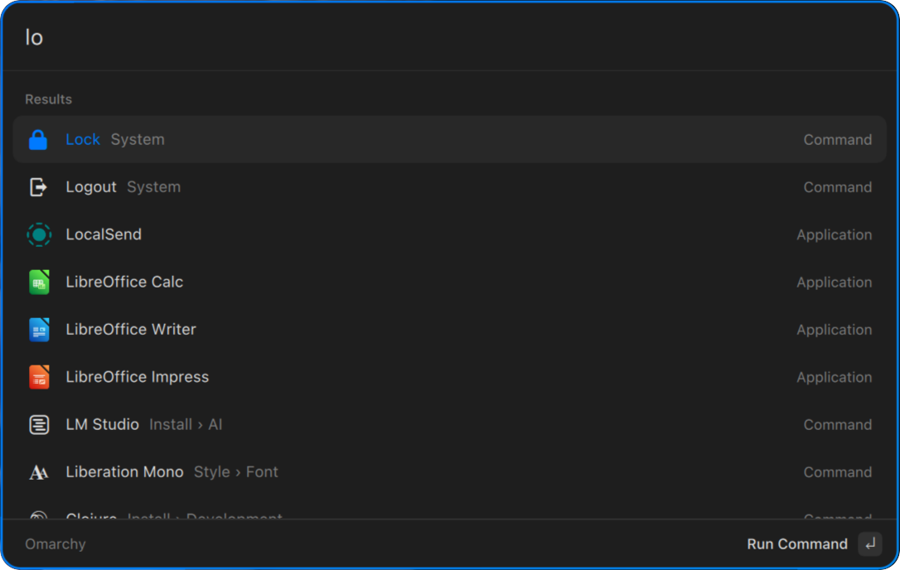

# Supermenu

A Raycast-style launcher for the [Omarchy](https://omarchy.org) 4 (Quickshell)
shell. One search box over every application and every entry in the Omarchy
menu, ranked by what you actually pick: type a query you have used before and
what you chose last time comes first.



- **Everything in one list.** Apps, Omarchy's commands and its submenus are
  searched together, each row showing where it lives (`Setup › Network`) and
  what it is (`Application`, `Command`, `Menu`).
- **It learns your queries.** Pick Tailscale after typing `sc` and the next `sc`
  puts Tailscale first, although Screenshot and Screensaver match `sc` better.
  What you learn for one query stays with that query.
- **It learns what you use.** Frequently used things drift up everywhere, and the
  empty search opens on your most-used ones, Raycast's *Suggestions*.
- **Fuzzy where it helps.** `lw` finds LibreOffice Writer, `vsc` VSCode,
  `setup dns` the DNS entry under Setup.
- **Omarchy's data, Omarchy's look.** It reads the same menu files, runs the
  same `when:` / `checked:` guards and the same app library as the Omarchy menu,
  and draws itself in the active theme's menu colours.

## Requirements

- Omarchy 4 (Quattro) and its Quickshell-based shell
- Hyprland, for the global-shortcuts protocol the keybind uses

## Install

```bash
omarchy plugin add https://github.com/cllpse/omarchy-cllpse-plugin-supermenu.git --enable
```

**Then install the keybind.** The plugin registers a global shortcut and waits
for the compositor to send it, so until this is in place `SUPER+SPACE` still
opens Omarchy's own menu. Append
[`hypr/supermenu-bindings.lua`](hypr/supermenu-bindings.lua) to
`~/.config/hypr/bindings.lua`:

```bash
cat ~/.config/omarchy/plugins/cllpse.supermenu/hypr/supermenu-bindings.lua \
  >> ~/.config/hypr/bindings.lua
hyprctl reload
```

That file unbinds Omarchy's `SUPER+SPACE` and binds it to the supermenu. Omarchy's
menu itself is untouched: `SUPER+ALT+SPACE` still opens its apps list, and every
script that uses it as a pick-from-a-list prompt still does.

Optionally append [`hypr/supermenu-looknfeel.lua`](hypr/supermenu-looknfeel.lua)
to `~/.config/hypr/looknfeel.lua` for blur and a map fade:

```bash
cat ~/.config/omarchy/plugins/cllpse.supermenu/hypr/supermenu-looknfeel.lua \
  >> ~/.config/hypr/looknfeel.lua
hyprctl reload
```

## Remove

```bash
omarchy plugin remove cllpse.supermenu
rm -f ~/.local/state/omarchy/cllpse.supermenu.json
```

Then delete the blocks you appended to `~/.config/hypr/bindings.lua` and
`~/.config/hypr/looknfeel.lua` and run `hyprctl reload`, which gives
`SUPER+SPACE` back to the Omarchy menu. The plugin writes one file, its usage
history, and nothing else.

## Using it

| | |
|---|---|
| `SUPER+SPACE` | open / close |
| type | search |
| `↑` `↓`, `Tab` `Shift+Tab`, `Ctrl+N` `Ctrl+P`, `Ctrl+J` `Ctrl+K` | move |
| `PgUp` `PgDn` | move eight rows |
| `Enter` or click | open the app, run the command, enter the submenu |
| `→` at the end of the query | enter the highlighted submenu |
| `Esc` | clear the query, then leave the submenu, then close |
| `Backspace` or `←` on an empty query | leave the submenu |
| `Ctrl+U` | clear the query |
| click outside the card | close |

Inside a submenu the search covers only what is under it, and rows show their
path from there.

It can also be opened at a submenu, or with a query, through the shell:

```bash
omarchy-shell shell summon cllpse.supermenu '{"menu":"style"}'
omarchy-shell shell summon cllpse.supermenu '{"query":"theme"}'
```

`menu` takes an id or any alias Omarchy's menu declares, as
`omarchy menu summon` does, and a route naming a command runs it.

## How results are ordered

Three tiers, strongest first:

1. **The exact name.** Typing a whole name always puts that thing first.
2. **What you picked for this exact query before**, most-picked first, at most
   three. A pick is remembered against the query you typed and every shorter
   prefix of it, weighted by how much of the query that prefix is: picking
   Tailscale after `tai` teaches `tai` fully, `ta` at two thirds and `t` at one
   third. A query you habitually stop early on is learned at full weight. A long
   query does not claim its one-letter prefix after a single use.
3. **Everything else that matches**, by match quality plus a small usage term.
   Usage breaks ties and lifts a slightly weaker match. It never lifts the
   middle of a word over a clean prefix; that gap is what tier 2 closes, for
   the queries where you showed the order was wrong.

Every count halves every two weeks, so the order follows what you do now, not
what you did in the spring. Something used daily settles near 20. Fifty uses
two months ago count for about 3. Each entry is one number and one timestamp,
with no log of individual uses, and anything that fades below 0.05 is dropped
when the file is written.

**Matching** is fuzzy on the name: the letters must appear in order, and the
score rewards what makes a match look intended — word starts, camelCase humps,
runs of consecutive letters, an early first letter — with fzf's own constants.
Aliases, an app's generic name and keywords, the row's menu path and its
description are matched as word prefixes, at a discount. Space-separated terms
must each match somewhere, so `lo w` is LibreOffice Writer.

The history lives in `~/.local/state/omarchy/cllpse.supermenu.json`. Delete it
to start over.

## Where the data comes from

All of it is Omarchy's, read the way the Omarchy menu reads it:

- **Menu entries**: `default/omarchy/omarchy-menu.jsonc` and your
  `~/.config/omarchy/extensions/omarchy-menu.jsonc`, both watched, parsed and
  merged by Omarchy's own `MenuModel.js`, which this plugin imports from where
  Omarchy installs it. `when:` hides a row and `checked:` marks it, evaluated by
  MenuModel's own batched script. A row under a hidden submenu is hidden too.
- **Provider rows** (`Style › Font`) come from the same bash one-liners the
  Omarchy menu runs. They run when their submenu is entered, and once in the
  background on the first open, so their rows are searchable from the top.
- **Apps** come from Omarchy's `AppLibrary`: the desktop entries with its hidden
  entry filters, its icon index, and its launch path with the *Launching…*
  feedback. Your `~/.icons` drop-ins therefore apply here as they do everywhere
  else.

## Performance

Measured inside the shell, on a corpus of 313 entries (55 apps):

| | |
|---|---|
| keystroke → ranked results | **0.16–0.19 ms** |
| rebuilding the visible rows | 0.2 ms |
| rebuilding the index (data changed) | 5–8 ms |
| `SUPER+SPACE` → card on screen | under 20 ms, including the `hyprctl` that sent it |

- **The keybind is a global shortcut**, a Wayland event straight into the shell,
  not an IPC call that starts a Quickshell process per keypress.
- **Nothing runs per keystroke but the ranking.** The index is built when the
  data changes, not when you type. A query that extends the last one only
  re-scores the last one's survivors.
- **Opening the card spawns at most one process**: the guard batch (~500 ms of
  bash here, most of it listing installed packages), in the background, never
  awaited. The card opens on the last answers and updates in place. It is
  skipped if the last batch started under ten seconds ago. The first open of a
  session also runs the provider one-liners and one icon refresh, both in the
  background.

`omarchy-shell shell call cllpse.supermenu bench ""` reruns the first three
measurements on your machine; `stats` reports what the index holds.

## Notes

- **Omarchy 4.0.4 never hands a third-party menu its app library.**
  `shell.qml` checks `Array.isArray(manifest.kinds)` on a manifest that has been
  through the panel loader's model, which turns the array into a sequence wrapper
  that `Array.isArray` rejects. So the plugin runs its own instance of Omarchy's
  `AppLibrary`. That costs one icon-index scan (~135 ms) and one hidden-entry
  scan (~155 ms), in the background at shell start and when apps change. Once
  the shell's own library arrives the plugin uses it instead, and `stats` shows
  `sharedAppLibrary: true`.
- `MenuModel.js` is imported from `/usr/share/omarchy/shell/plugins/menu/`. QML
  imports are static, so an Omarchy installed anywhere else needs that one line
  changed.
- The plugin runs inside the existing Omarchy shell process. Live edits to its
  files are not always picked up; run `omarchy-restart-shell` after changing
  them.

## Development

```bash
node test/search.test.js   # the ranking rules, plus a check against your own menu
node test/bench.js         # per-keystroke cost under node (a floor; use `bench` above)
```

Everything that decides the order is in [`Search.js`](Search.js), which is plain
JavaScript and runs under node unchanged. [`Supermenu.qml`](Supermenu.qml)
gathers the data and draws the card.

## License

MIT
